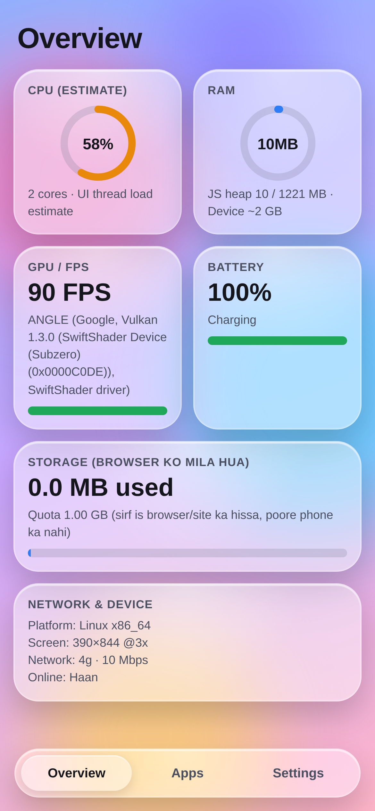
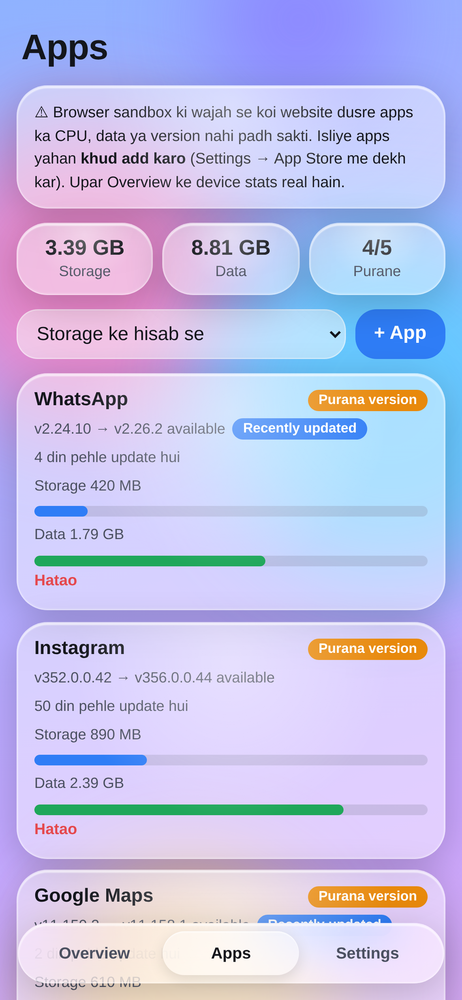
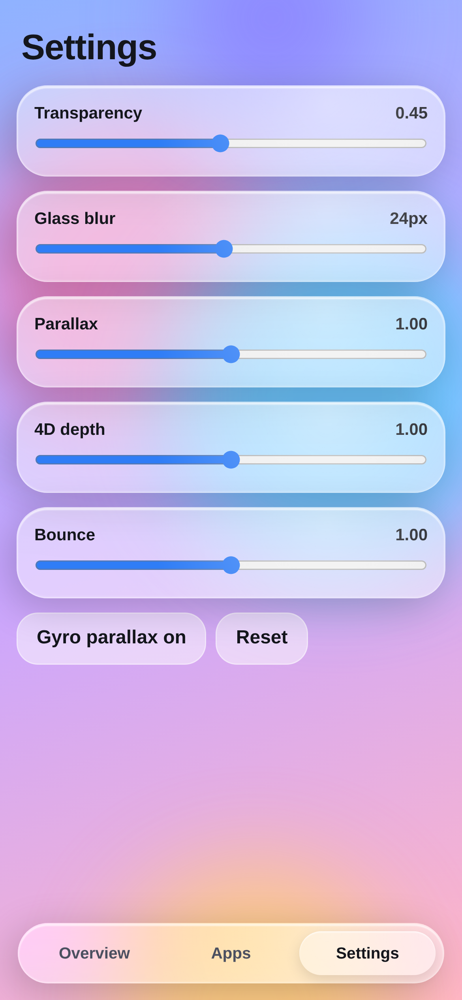
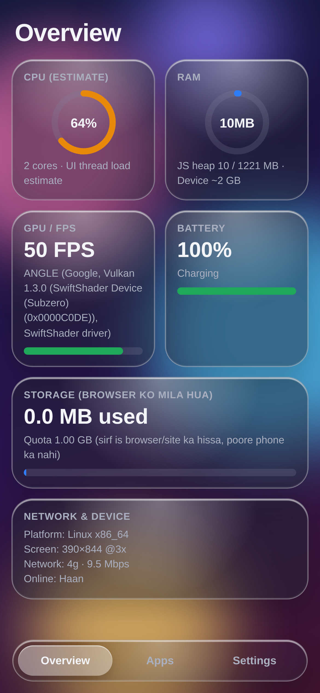
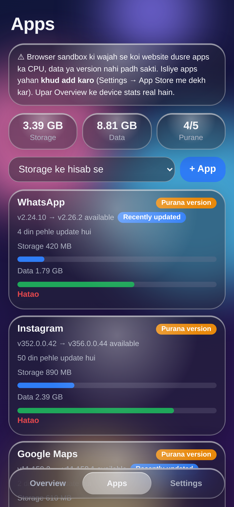

# Task Manager

A real, installable Android app built from the single-file web app `Task_Manager.html`.

The HTML file is bundled byte-for-byte inside the APK and runs in a full-screen
`WebView` with JavaScript, DOM storage and localStorage enabled — so everything the
page does (device stats, app tracking, glass/parallax settings) works offline inside
the app, and your data survives restarts.

| | |
|---|---|
| Package | `com.hubclue.taskmanager` |
| Version | 1.1 (versionCode 2) |
| Min SDK | 21 (Android 5.0) |
| Target SDK | 34 (Android 14) |
| Permissions | **none** — the app never touches the network |
| Size | ~102 KB |
| APK | [`Task_Manager.apk`](Task_Manager.apk) |

## Screenshots

| Overview | Apps |
|---|---|
|  |  |

| Settings | Dark mode |
|---|---|
|  |  |



> Captured at 1170 × 2532 (390 × 844 CSS px @3x) from the same HTML that ships in the
> APK. Everything on the Overview tab is measured live, so CPU / RAM / FPS / GPU
> describe the machine that rendered the screenshot (a headless Linux browser with a
> software GPU) — on a phone those cards show that phone's numbers instead.

## Install

1. Download `Task_Manager.apk` to your phone.
2. Tap it and allow "Install unknown apps" for your browser / file manager when asked.
3. Open **Task Manager** from the app drawer.

The APK is signed with a self-signed release key (v1 + v2 + v3 signatures), so it
installs on stock Android. Because the key is not from Play, Android may show the usual
"sideloaded app" prompt the first time — that is expected. Version 1.1 is signed with the
same key as 1.0, so it installs straight over it.

## What's inside the app

Same three tabs as the HTML, nothing removed:

- **Overview** — live CPU load estimate (JS benchmark), JS heap / RAM, FPS and GPU
  renderer, battery level and charging state, browser storage quota, device and
  network info. All of it is measured from the real device at runtime.
- **Apps** — add your installed apps with version, latest version, update date,
  storage and data use. Sortable, with stale-version detection and totals.
  (Android does not let a WebView enumerate installed packages, which is why the
  page asks you to enter them — the note in the app says the same.)
- **Settings** — glass transparency, blur radius, parallax, 4D depth and bounce
  sliders, plus gyroscope parallax. Saved to localStorage.

## How the native shell works

`src/com/hubclue/taskmanager/MainActivity.java` is the whole native side (~200 lines):

- Creates a `WebView` with `setJavaScriptEnabled(true)` and `setDomStorageEnabled(true)`.
- Serves the bundled page from a virtual secure origin, `https://app.taskmanager.local/index.html`,
  answered entirely from `assets/www` inside the APK by `shouldInterceptRequest()`.
  A real `https` origin is what makes `localStorage` behave exactly like it does in a
  browser; `file://` origins are unreliable for storage on modern WebView versions.
- No `INTERNET` permission is declared, so the page physically cannot phone home.
- Keeps the page alive across rotation (`configChanges`), handles the Back button,
  and opens any external link in the system browser.
- Background colour and status/navigation bars match the page gradient, no action bar.

## Launcher icon

- Legacy icons (`mipmap-*/ic_launcher.png`, 48 → 192 px) for Android 5–7.
- An adaptive icon (`mipmap-anydpi-v26/ic_launcher.xml` + background/foreground layers,
  108 dp canvas, artwork inside the 72 dp safe zone) for Android 8+, so the launcher can
  mask it to a circle, squircle or rounded square without cropping the mark.
- `tools/make_icons.py` draws all of them with Pillow; run it after changing the colours.

## Build it yourself

No Gradle, no Android Studio — just the SDK build-tools:

```bash
export ANDROID_HOME=$HOME/Android/Sdk      # needs build-tools;34.0.0 and platforms;android-34
./build.sh
```

`build.sh` runs the five real steps: `aapt2 compile` → `aapt2 link` (resources +
assets) → `javac`/`ecj` against `android.jar` → `d8` to `classes.dex` →
`zipalign` → `apksigner sign`. Output is `Task_Manager.apk`.

Regenerate the launcher icons (needs Pillow) with:

```bash
python3 tools/make_icons.py
```

## Repo layout

```
AndroidManifest.xml
build.sh                          one-shot build script
assets/www/index.html             the original web app, unchanged
src/com/hubclue/taskmanager/MainActivity.java
res/values/{strings,colors,styles}.xml
res/mipmap-anydpi-v26/ic_launcher.xml   adaptive icon
res/mipmap-*/ic_launcher*.png           legacy + adaptive icon layers
screenshots/                      README screenshots (1170 × 2532)
tools/make_icons.py               icon generator
tools/icon-512.png                store-size icon
Task_Manager.apk                  signed, installable build
```

## Notes

- The signing keystore is generated by `build.sh` on first run and is not committed.
  If you plan to publish updates, keep your own keystore safe — Android will refuse
  to update an app whose signing key has changed.
- The web app inside is unmodified, so anything you change in `Task_Manager.html`
  can simply be copied over `assets/www/index.html` and rebuilt.
