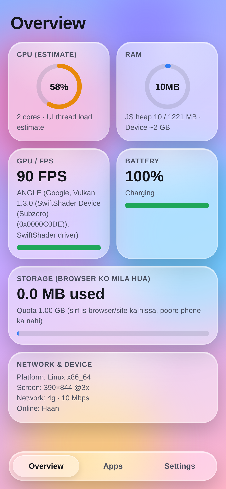
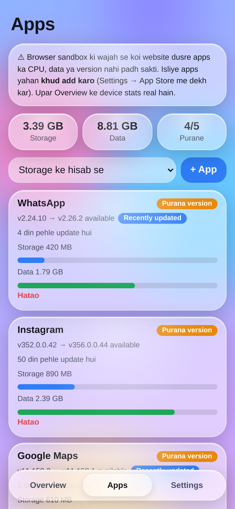
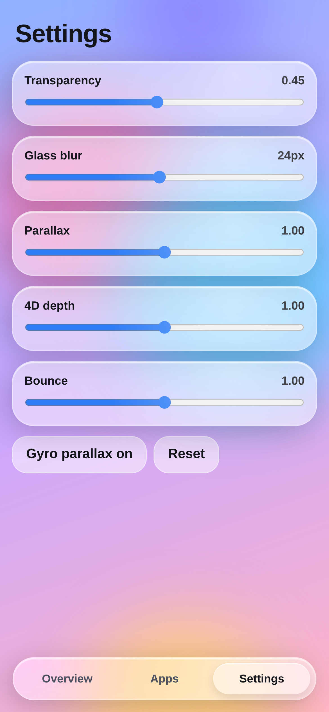
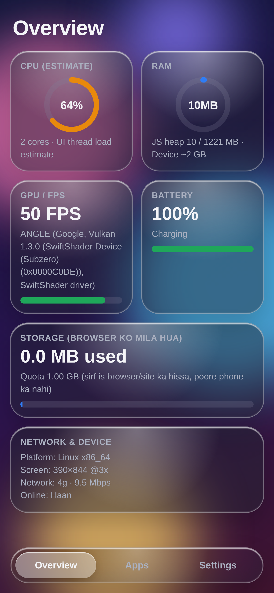
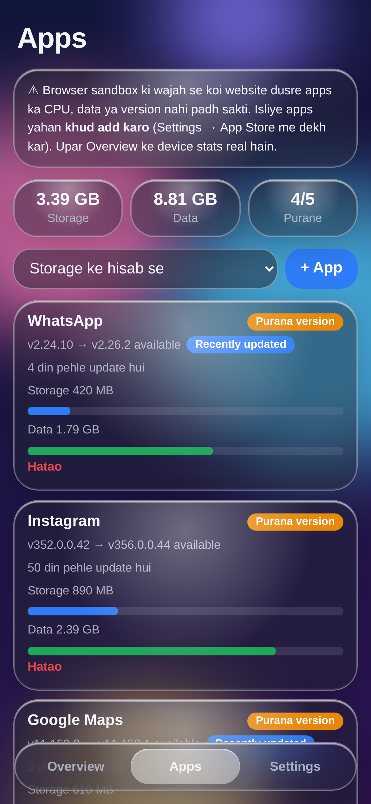

<div align="center">

<a href="https://github.com/technicalnihilist-lgtm/Task_Manager/stargazers"></a>&nbsp;<a href="https://github.com/technicalnihilist-lgtm/Task_Manager/network/members"></a>

<h3>Real installable Android APK built from Task_Manager.html - WebView shell, device stats, app…</h3>

   

<b>Support the work</b>

  

<sub>Donations aren't live yet — Paytm, UPI, PayPal and Buy&nbsp;Me&nbsp;a&nbsp;Coffee all show <b>coming soon</b>. Until then, a ⭐ star is the best support.</sub>

<h4>Get it from</h4>

<a href="https://github.com/technicalnihilist-lgtm/Task_Manager"></a> <a href="https://github.com/technicalnihilist-lgtm/Task_Manager/archive/refs/heads/main.zip"></a>

</div>

---

---

## Screenshots

| Overview | Apps |
|---|---|
|  |  |

| Settings | Dark mode |
|---|---|
|  |  |



> Captured at 1170 × 2532 (390 × 844 CSS px @3x) from the same HTML that ships in the
> APK. Everything on the Overview tab is measured live, so CPU / RAM / FPS / GPU
> describe the machine that rendered the screenshot (a headless Linux browser with a
> software GPU) — on a phone those cards show that phone's numbers instead.

## Install

1. Download `Task_Manager.apk` to your phone.
2. Tap it and allow "Install unknown apps" for your browser / file manager when asked.
3. Open **Task Manager** from the app drawer.

The APK is signed with a self-signed release key (v1 + v2 + v3 signatures), so it
installs on stock Android. Because the key is not from Play, Android may show the usual
"sideloaded app" prompt the first time — that is expected. Version 1.1 is signed with the
same key as 1.0, so it installs straight over it.

## What's inside the app

Same three tabs as the HTML, nothing removed:

- **Overview** — live CPU load estimate (JS benchmark), JS heap / RAM, FPS and GPU
  renderer, battery level and charging state, browser storage quota, device and
  network info. All of it is measured from the real device at runtime.
- **Apps** — add your installed apps with version, latest version, update date,
  storage and data use. Sortable, with stale-version detection and totals.
  (Android does not let a WebView enumerate installed packages, which is why the
  page asks you to enter them — the note in the app says the same.)
- **Settings** — glass transparency, blur radius, parallax, 4D depth and bounce
  sliders, plus gyroscope parallax. Saved to localStorage.

## How the native shell works

`src/com/hubclue/taskmanager/MainActivity.java` is the whole native side (~200 lines):

- Creates a `WebView` with `setJavaScriptEnabled(true)` and `setDomStorageEnabled(true)`.
- Serves the bundled page from a virtual secure origin, `https://app.taskmanager.local/index.html`,
  answered entirely from `assets/www` inside the APK by `shouldInterceptRequest()`.
  A real `https` origin is what makes `localStorage` behave exactly like it does in a
  browser; `file://` origins are unreliable for storage on modern WebView versions.
- No `INTERNET` permission is declared, so the page physically cannot phone home.
- Keeps the page alive across rotation (`configChanges`), handles the Back button,
  and opens any external link in the system browser.
- Background colour and status/navigation bars match the page gradient, no action bar.

## Launcher icon

- Legacy icons (`mipmap-*/ic_launcher.png`, 48 → 192 px) for Android 5–7.
- An adaptive icon (`mipmap-anydpi-v26/ic_launcher.xml` + background/foreground layers,
  108 dp canvas, artwork inside the 72 dp safe zone) for Android 8+, so the launcher can
  mask it to a circle, squircle or rounded square without cropping the mark.
- `tools/make_icons.py` draws all of them with Pillow; run it after changing the colours.

## Build it yourself

No Gradle, no Android Studio — just the SDK build-tools:

```bash
export ANDROID_HOME=$HOME/Android/Sdk      # needs build-tools;34.0.0 and platforms;android-34
./build.sh
```

`build.sh` runs the five real steps: `aapt2 compile` → `aapt2 link` (resources +
assets) → `javac`/`ecj` against `android.jar` → `d8` to `classes.dex` →
`zipalign` → `apksigner sign`. Output is `Task_Manager.apk`.

Regenerate the launcher icons (needs Pillow) with:

```bash
python3 tools/make_icons.py
```

## Repo layout

```
AndroidManifest.xml
build.sh                          one-shot build script
assets/www/index.html             the original web app, unchanged
src/com/hubclue/taskmanager/MainActivity.java
res/values/{strings,colors,styles}.xml
res/mipmap-anydpi-v26/ic_launcher.xml   adaptive icon
res/mipmap-*/ic_launcher*.png           legacy + adaptive icon layers
screenshots/                      README screenshots (1170 × 2532)
tools/make_icons.py               icon generator
tools/icon-512.png                store-size icon
Task_Manager.apk                  signed, installable build
```

## Notes

- The signing keystore is generated by `build.sh` on first run and is not committed.
  If you plan to publish updates, keep your own keystore safe — Android will refuse
  to update an app whose signing key has changed.
- The web app inside is unmodified, so anything you change in `Task_Manager.html`
  can simply be copied over `assets/www/index.html` and rebuilt.

---

---

## 🌍 Languages

<sub>Donations are <b>coming soon</b> in every language below — nothing to pay today, nothing to click.</sub>

<div align="center">

<sub><b>हिन्दी · বাংলা · मराठी · తెలుగు · தமிழ் · ગુજરાતી · ಕನ್ನಡ · മലയാളം · ਪੰਜਾਬੀ · ଓଡ଼ିଆ · অসমীয়া · اردو</b></sub>

</div>

<details>
<summary><b>🌍 Open the same message in 53 languages</b></summary>

**🇮🇳 Indian languages**

- **हिन्दी** (Hindi) — ☕ जल्द ही आ रहा है। · ⭐ अगर आपको यह ऐप और हमारा काम पसंद है, तो कृपया रिपॉजिटरी को स्टार दें और हमें फॉलो करें।
- **বাংলা** (Bengali) — ☕ খুব শিগগিরই আসছে। · ⭐ যদি আপনার এই অ্যাপ এবং আমাদের কাজ ভালো লাগে, তবে অনুগ্রহ করে রিপোজিটরিটিকে একটি স্টার দিন এবং আমাদের ফলো করুন।
- **मराठी** (Marathi) — ☕ लवकरच येत आहे. · ⭐ जर तुम्हाला हे ॲप आणि आमचं काम आवडलं असेल, तर कृपया रिपॉझिटरीला स्टार द्या आणि आम्हाला फॉलो करा.
- **తెలుగు** (Telugu) — ☕ త్వరలో రాబోతోంది. · ⭐ మీకు ఈ యాప్, మా పని నచ్చితే, దయచేసి రిపోజిటరీకి ఒక స్టార్ ఇచ్చి మమ్మల్ని ఫాలో అవ్వండి.
- **தமிழ்** (Tamil) — ☕ விரைவில் வருகிறது. · ⭐ உங்களுக்கு இந்த ஆப்பும் எங்க வேலையும் பிடிச்சிருந்தா, தயவுசெஞ்சு இந்த ரெபாசிட்டரிக்கு ஒரு ஸ்டார்…
- **ગુજરાતી** (Gujarati) — ☕ ટૂંક સમયમાં આવી રહ્યું છે. · ⭐ જો તમને આ એપ અને અમારું કામ ગમતું હોય, તો પ્લીઝ રિપોઝિટરીને સ્ટાર આપો અને અમને ફોલો કરો.
- **ಕನ್ನಡ** (Kannada) — ☕ ಶೀಘ್ರದಲ್ಲೇ ಬರುತ್ತಿದೆ. · ⭐ ನಿಮಗೆ ಈ ಆ್ಯಪ್ ಮತ್ತು ನಮ್ಮ ಕೆಲಸ ಇಷ್ಟವಾದರೆ, ದಯವಿಟ್ಟು ರೆಪೊಸಿಟರಿಗೆ ಸ್ಟಾರ್ ಕೊಡಿ ಮತ್ತು ನಮ್ಮನ್ನು ಫಾಲೋ ಮಾಡಿ.
- **മലയാളം** (Malayalam) — ☕ ഉടൻ വരുന്നു. · ⭐ നിങ്ങൾക്ക് ഈ ആപ്പും ഞങ്ങളുടെ പ്രവർത്തനവും ഇഷ്ടപ്പെട്ടെങ്കിൽ, ദയവായി റെപ്പോസിറ്ററിക്ക് ഒരു സ്റ്റാർ…
- **ਪੰਜਾਬੀ** (Punjabi) — ☕ ਜਲਦੀ ਆ ਰਿਹਾ ਹੈ। · ⭐ ਜੇ ਤੁਹਾਨੂੰ ਇਹ ਐਪ ਅਤੇ ਸਾਡਾ ਕੰਮ ਪਸੰਦ ਹੈ, ਤਾਂ ਕਿਰਪਾ ਕਰਕੇ ਰਿਪੋਜ਼ਟਰੀ ਨੂੰ ਸਟਾਰ ਦਿਓ ਅਤੇ ਸਾਨੂੰ ਫਾਲੋ ਕਰੋ।
- **ଓଡ଼ିଆ** (Odia) — ☕ ଖୁବ୍ ଶୀଘ୍ର ଆସୁଛି। · ⭐ ଯଦି ଆପଣଙ୍କୁ ଏହି ଆପ୍ ଏବଂ ଆମର କାମ ଭଲ ଲାଗୁଛି, ତେବେ ଦୟାକରି ରିପୋଜିଟୋରୀକୁ ଗୋଟିଏ ଷ୍ଟାର୍ ଦିଅନ୍ତୁ ଏବଂ ଆମକୁ ଫଲୋ କରନ୍ତୁ।
- **অসমীয়া** (Assamese) — ☕ অতি সোনকালেই আহি আছে। · ⭐ যদি আপুনি এই এপটো আৰু আমাৰ কাম ভাল পায়, তেন্তে অনুগ্ৰহ কৰি ৰিপজিটৰীটোক এটা ষ্টাৰ দিয়ক আৰু আমাক ফ'ল' কৰক।
- **اردو** (Urdu) — ☕ جلد آرہا ہے۔ · ⭐ اگر آپ کو یہ ایپ اور ہمارا کام پسند آئے تو براہ کرم ریپازٹری کو سٹار دیں اور ہمیں فالو کریں۔
- **संस्कृतम्** (Sanskrit) — ☕ शीघ्रमेव आगच्छति।
- **मैथिली** (Maithili) — ☕ जल्दिये आबि रहल अछि।
- **कोंकणी** (Konkani) — ☕ रोखडेंच येता.
- **کٲشُر** (Kashmiri) — ☕ جَلدی یِوان چھُ۔
- **سنڌي** (Sindhi) — ☕ जल्द अची रह्यो आहे।
- **डोगरी** (Dogri) — ☕ जल्दी आ करदा ऐ।
- **ꯃꯤꯇꯩ ꯂꯣꯟ** (Manipuri) — ☕ ꯑꯊꯨꯕꯥ ꯃꯇꯝꯗꯥ ꯂꯥꯛꯀꯅꯤ꯫
- **बर’** (Bodo) — ☕ थाबैनो फैगोन।
- **ᱥᱟᱱᱛᱟᱲᱤ** (Santali) — ☕ ᱞᱚᱜᱚᱱ ᱦᱤᱡᱩᱜ ᱠᱟᱱᱟ᱾
- **नेपाली** (Nepali) — ☕ छिट्टै आउँदैछ। · ⭐ यदि तपाईंलाई यो एप र हाम्रो काम मन पर्‍यो भने, कृपया रिपोजिटरीलाई स्टार दिनुहोस् र हामीलाई फलो गर्नुहोस्।

**🌍 World languages**

- **العربية** (Arabic) — ☕ قريبًا. · ⭐ إذا أعجبك هذا التطبيق وعملنا، فيرجى منح المستودع نجمة ومتابعتنا.
- **简体中文** (Chinese (Simplified)) — ☕ 即将推出。
- **繁體中文** (Chinese (Traditional)) — ☕ 即將推出。
- **Čeština** (Czech) — ☕ Již brzy.
- **Dansk** (Danish) — ☕ Kommer snart.
- **Nederlands** (Dutch) — ☕ Binnenkort beschikbaar. · ⭐ Vind je deze app en ons werk leuk?
- **Filipino** (Filipino) — ☕ Malapit na.
- **Suomi** (Finnish) — ☕ Tulossa pian.
- **Français** (French) — ☕ Bientôt disponible. · ⭐ Si cette application et notre travail vous plaisent, mettez une étoile au dépôt et suivez-nous.
- **Deutsch** (German) — ☕ Bald verfügbar. · ⭐ Wenn dir diese App und unsere Arbeit gefallen, gib dem Repository einen Stern und folge uns.
- **Ελληνικά** (Greek) — ☕ Έρχεται σύντομα.
- **עברית** (Hebrew) — ☕ בקרוב.
- **Magyar** (Hungarian) — ☕ Hamarosan.
- **Bahasa Indonesia** (Indonesian) — ☕ Segera hadir. · ⭐ Jika kamu suka aplikasi ini dan karya kami, beri bintang pada repositori ini dan ikuti kami.
- **Italiano** (Italian) — ☕ In arrivo.
- **日本語** (Japanese) — ☕ 近日公開。 · ⭐ このアプリと私たちの仕事が気に入ったら、リポジトリにスターを付けてフォローしてください。
- **한국어** (Korean) — ☕ 곧 공개됩니다. · ⭐ 이 앱과 저희 작업이 마음에 드신다면 저장소에 스타를 눌러 주시고 팔로우해 주세요.
- **Bahasa Melayu** (Malay) — ☕ Akan datang.
- **Norsk** (Norwegian) — ☕ Kommer snart.
- **فارسی** (Persian) — ☕ به‌زودی.
- **Polski** (Polish) — ☕ Wkrótce. · ⭐ Jeśli podoba Ci się ta aplikacja i nasza praca, daj repozytorium gwiazdkę i obserwuj nas.
- **Português** (Portuguese) — ☕ Em breve.
- **Română** (Romanian) — ☕ În curând.
- **Русский** (Russian) — ☕ Скоро. · ⭐ Если вам нравится это приложение и наша работа, поставьте звёздочку репозиторию и подпишитесь на нас.
- **Español** (Spanish) — ☕ Muy pronto. · ⭐ Si te gusta esta app y nuestro trabajo, dale una estrella al repositorio y síguenos.
- **Kiswahili** (Swahili) — ☕ Inakuja hivi karibuni.
- **Svenska** (Swedish) — ☕ Kommer snart.
- **ไทย** (Thai) — ☕ เร็ว ๆ นี้
- **Türkçe** (Turkish) — ☕ Çok yakında.
- **Українська** (Ukrainian) — ☕ Незабаром.
- **Tiếng Việt** (Vietnamese) — ☕ Sắp ra mắt. · ⭐ Nếu bạn thích ứng dụng này và công việc của chúng tôi, hãy tặng kho lưu trữ một ngôi sao và theo…

</details>

